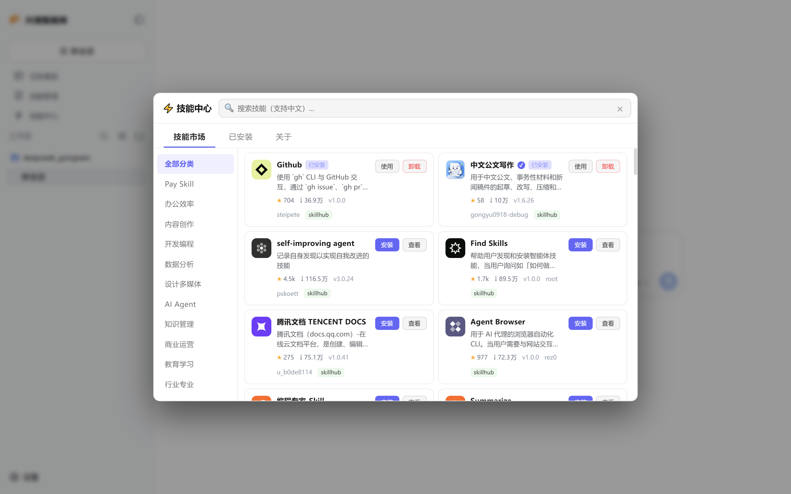
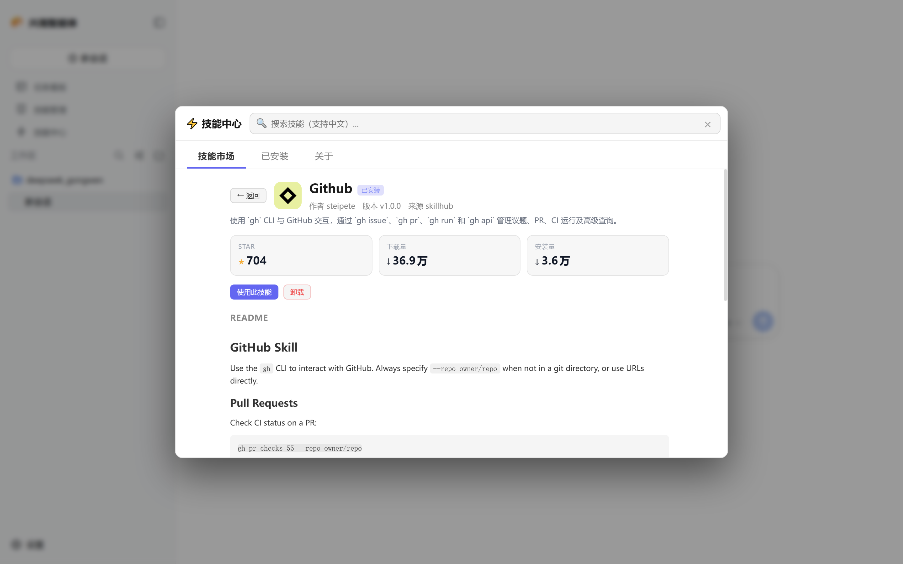
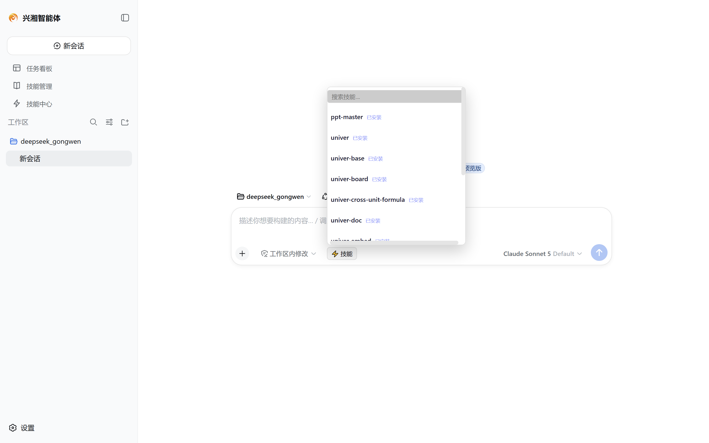

# dsh-skill-market

**简体中文** | [English](./README.en.md)

DeepSeek Harness 技能市场插件 —— 聚合 SkillHub + ClawHub 双数据源，站内 README 预览，一键安装/卸载，聊天栏技能选择器，侧边栏技能市场面板。

<p align="center">
  
</p>

## 功能

- **搜索技能**：聚合 SkillHub（腾讯云中国镜像，高速直连）和 ClawHub（OpenClaw 官方源）双数据源，支持中文搜索
- **一键安装/卸载**：安装到 `$DSH_HOME/skills/` 目录，skill-filesystem 自动热发现
- **站内 README 预览**：无需跳转外部页面，详情页原生渲染 Markdown
- **Star / 下载量展示**：卡片与详情页均展示 star、下载量、安装量统计
- **技能市场面板**：侧边栏入口 → 全屏弹窗，搜索、安装、浏览、查看一站式
- **聊天栏快捷入口**：输入栏「⚡ 技能」按钮，快速选择已装技能，自动填入 `/技能名`
- **多源容错**：SkillHub 失败自动回退 ClawHub，反之亦然

## 设计原则：不修改宿主 UI

本插件**只新增自己的界面元素，绝不改动 DSH 宿主（官方）的任何 UI**：

- 不替换、不隐藏侧边栏官方鲸鱼 logo 与 `deepseek harness` 字标
- 不修改浏览器 favicon
- 不改名、不隐藏宿主自带的「技能中心」（skill explorer）等任何官方入口
- 不使用 MutationObserver 对宿主元素做"改名/替换"式自愈

插件自身的侧边栏入口固定命名为「**技能市场**」，与官方的「技能中心」（管理**已加载**技能）天然区分：一个负责**安装**技能，一个负责**管理**已装技能。若出现两个同名入口，说明你装的是旧版本，请升级到 `>=1.0.1`。

## 界面预览

| 技能市场 | 技能详情 |
|---|---|
|  |  |

聊天输入栏技能选择器：

<p align="center">
  
</p>

## 安装

```bash
dsh plugin --profile web add "github:pn1024/dsh-skill-market"
```

或本地路径安装：

```bash
dsh plugin --profile web add "/path/to/dsh-skill-market"
```

## 架构

```
dsh-skill-market/
├── package.json           # dsh.bundle.patch + dsh.client 声明
├── cordis.patch.yml       # 插件行注册 + 配置
├── src/
│   ├── index.js           # Host 端：RPC intercept (skill-hub/*)
│   └── client.js          # Browser 端：UI 插槽注册 (sidebar/overlay/input)
├── docs/screenshots/      # 界面截图
├── LICENSE
└── README.md
```

### Host 端 RPC 端点

| 端点 | 功能 |
|------|------|
| `skill-hub/search` | 搜索技能（SkillHub + ClawHub 双源聚合） |
| `skill-hub/detail` | 获取技能详情（README、版本、统计） |
| `skill-hub/installed` | 列出本地已安装技能 |
| `skill-hub/install` | 下载并安装技能到本地 |
| `skill-hub/uninstall` | 卸载本地技能 |
| `skill-hub/readme` | 读取已安装技能的 README/SKILL.md |

### Browser 端 UI 插槽

| 插槽 | 功能 |
|------|------|
| `sidebar.footer.action` | 侧边栏「技能市场」入口按钮（仅新增，不改动官方入口） |
| `shell.overlay` | 技能市场全屏弹窗面板 |
| `conversation.input.left` | 聊天输入栏「⚡ 技能」快捷选择器 |

## 数据源

| 平台 | API Base | 特点 |
|------|----------|------|
| SkillHub | `https://api.skillhub.tencent.com` | 腾讯云中国镜像，高速直连，支持中文搜索 |
| ClawHub | `https://clawhub.com` | OpenClaw 官方技能社区，全球可用 |

## 配置

在 `cordis.patch.yml` 中可配置：

```yaml
- insert:
    - id: dsh-skill-market
      name: 'dsh-skill-market'
      config:
        skillhubApiBase: https://api.skillhub.tencent.com
        clawhubApiBase: https://clawhub.com
        localSkillsDir: ''        # 空则用 $DSH_HOME/skills
        preferSkillHub: true       # 中国用户优先用 SkillHub
```

## License

MIT
